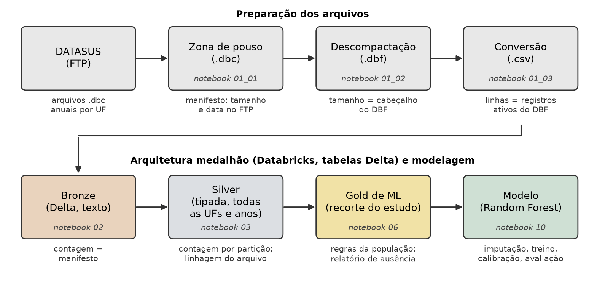

# Data Engineering and Low Birth Weight Prediction in the Metropolitan Region of Jundiaí

Code and results of the undergraduate thesis (*Trabalho de Conclusão de Curso*) presented to the Technologist Degree in Data Science at Faculdade de Tecnologia de Jundiaí "Deputado Ary Fossen" (Fatec Jundiaí, Centro Paula Souza), São Paulo, Brazil, 2026.

- **Author:** Riquelmy Henrique Silva
- **Advisor:** Prof. Me. Ricardo Leardini Lobo

The thesis text is written in Portuguese, and so are the comments inside the notebooks. This README summarizes the study in English and explains how the repository is organized.

## Research question

Can routinely collected maternal characteristics, available at the **first prenatal visit**, predict **low birth weight** (< 2,500 g) in the Metropolitan Region of Jundiaí (RMJ), and how well does such a model hold up in later years?

Low birth weight is one of the main determinants of neonatal mortality. A model that only uses information available early in pregnancy could, in principle, help prioritize prenatal follow-up. Most published models reach high discrimination by including information that is only known at or after delivery (gestational age, type of delivery, Apgar score). This study deliberately excludes such variables.

## Data

- **Source:** Brazilian Live Birth Information System (SINASC), public microdata distributed by DATASUS (Ministry of Health) via FTP. **No data files are included in this repository**; the pipeline downloads them.
- **Files used:** the São Paulo state file for 2012–2024 and the preliminary 2025 file (version released on 27 August 2026).
- **Population:** live births to mothers residing in the seven RMJ municipalities (Cabreúva, Campo Limpo Paulista, Itupeva, Jarinu, Jundiaí, Louveira and Várzea Paulista), singleton pregnancies, recorded birth weight ≥ 500 g. Total: 147,488 births.
- **Outcome:** birth weight < 2,500 g.
- **Predictors (9):** maternal age, previous pregnancies, previous vaginal deliveries, previous cesarean deliveries, living children, fetal losses and abortions, race/skin color, education (2010 classification) and marital status.

2012 is the first year in which all nine predictors are recorded. 2026 is incomplete and was not used.

## Data engineering

The pipeline runs on Databricks and follows the medallion architecture with Delta tables.



| Notebook | Role | Completeness check |
|---|---|---|
| `01_01_import_to_landingzone` | Downloads the `.dbc` files from the DATASUS FTP to the landing zone | Manifest with FTP size and modification date; a file is downloaded again only if it changed |
| `01_02_unpack_dbc_to_dbf` | Unpacks `.dbc` into `.dbf` | DBF size equals the size declared in its header |
| `01_03_convert_dbf_to_csv` | Converts `.dbf` into `.csv` | Written to a temporary file; row count equals the number of active DBF records |
| `02_load_bronze` | Loads the CSV into Bronze, with no type conversion | Row count equals the manifest |
| `03_load_silver` | Casts types, standardizes names, records lineage and partitions by state and year (Silver) | Row count per partition equals Bronze; Delta version recorded |
| `06_load_gold_ml` | Builds the study table (Gold for ML): population rules, outcome and predictors | Rebuilt only if the Silver version or the parameters change; population report |
| `10_tcc_rf_baixo_peso_rmj` | Imputation, training, calibration and evaluation of the model | Checks that the Gold table version matches the population report |

`00_01_setup` creates the schema and volumes, and `00_02_schema_contracts` holds the shared file contracts, included by the other notebooks with `%run`.

Each step checks the previous one and only reprocesses data when its input changes, so the job can be re-run safely. Imputation and encoding are **not** done in the Gold layer: they learn from the data, and fitting them on all years would leak information from the validation and test periods. They live in the model notebook and are fitted on the training period only.

## Modeling

- **Temporal split:** training 2012–2021 (109,134 births, 7.40% low birth weight), validation 2022–2023 (19,965; 7.99%) and test 2024–2025 (18,389; 7.63%).
- **Missing data:** values coded as "ignored" or outside the valid range (0.001% to 0.72% per predictor) are treated as missing and filled by **multiple imputation** with chained equations (M = 5), fitted on the training period only and without the outcome.
- **Model:** one Random Forest (scikit-learn 1.3.0, 300 trees, square root of the number of features at each split) per imputed dataset; the final probability is the average of the five forests.
- **Hyperparameters:** maximum depth, minimum samples per leaf and class weighting, chosen from a 50-combination grid by the highest AUC-PR on validation.
- **Calibration:** Platt scaling fitted on validation.
- **Evaluation on the test set only:** AUC-ROC and AUC-PR with 1,000 bootstrap resamples; Brier score; calibration intercept, slope and observed/expected ratio; calibration curve by deciles; operating points (top 5%, 10%, 20% and 30% of scores, thresholds set on validation); performance by year and municipality; case-mix-corrected AUC; permutation importance; and sensitivity analyses of the population definition.

Reporting follows the TRIPOD statement.

## Main results (test set, 2024–2025)

| Measure | Value (95% CI) |
|---|---|
| AUC-ROC | 0.567 (0.552–0.582) |
| AUC-PR | 0.094 (0.088–0.102), prevalence 0.076 |
| Brier score | 0.0703, vs 0.0705 for predicting the training prevalence for everyone |
| Calibration intercept | −0.057 (−0.112 to −0.004) |
| Calibration slope | 0.70 (0.54–0.86) |
| Observed/expected ratio | 0.95 (0.90–1.00) |
| Top 10% of scores | sensitivity 14.6% (12.9–16.4), PPV 11.1% (9.8–12.6), lift 1.46 |

- **Discrimination is weak.** It is in line with studies that also exclude delivery information, such as Ren et al. (2023), with AUC-ROC around 0.57.
- **The drop from validation to test is drift, not case-mix.**
  - AUC-ROC fell from 0.593 on validation to 0.567 on test.
  - The spread of predicted risks was the same in both periods, and the case-mix-corrected AUC is 0.594 in both.
  - This means the associations between predictors and outcome weakened in 2024–2025, which matches the calibration slope below 1.
- **Platt scaling did not help on the test set.**
  - The raw Random Forest score was better calibrated there: slope 1.16 (0.90–1.42), O/E 1.03 (0.97–1.08).
  - Platt scaling had amplified risk differences that weakened in the test years.
  - It was kept because it had been specified before the test set was evaluated.
- **The model is not ready for clinical use.**
  - Practical use would require refitting on all available years and periodic recalibration.
  - It would also require external validation and, ideally, predictors not recorded in SINASC, such as maternal weight, height and pregnancy complications.

## Repository structure

```
databricks/
  pipeline/    ingestion and preparation notebooks (00_01 to 06), Databricks source format
  model/       10_tcc_rf_baixo_peso_rmj.py   main model (version 4)
               12_tcc_teste_atributos_extras.py   supplementary test of extra SINASC fields
  jobs/        pipeline_sinasc_job.json      job definition for the pipeline notebooks
analysis/
  ic_calibracao.py          bootstrap CIs for calibration, with and without Platt scaling
  gerar_fig_taxa_ano.py     figure: low birth weight rate by year
  gerar_fig_arquitetura.py  figure: pipeline architecture
results/
  model_v4/          resultados.json (all metrics), ic_calibracao.json, figures and
                     predicoes_validacao_teste.csv (predicted probabilities per birth)
  extra_attributes/  results of the supplementary test
  figures/           figures used in the thesis text
```

The supplementary notebook (`12`) evaluated maternal birthplace and occupation as extra predictors and measured the completeness of other excluded fields. It used a preliminary version of the model, with single imputation, and the same validation design.

## How to run

**On Databricks**

1. Import the notebooks from `databricks/pipeline/` and `databricks/model/` into a workspace folder (the job expects `/SINASC Project/`).
2. Create the pipeline job from `databricks/jobs/pipeline_sinasc_job.json`. It runs setup, download, unpacking, conversion, Bronze, Silver and the Gold table for ML.
3. Run `10_tcc_rf_baixo_peso_rmj` after the job. It writes the results, figures and predictions to the output folder set in its parameters.

The notebooks depend on Spark, `dbutils` and Unity Catalog volumes. They are not standalone scripts. Study parameters (period, municipalities, minimum weight, singleton restriction, data source) are notebook widgets.

**Locally**, for the post-processing scripts:

```bash
pip install -r requirements.txt
python analysis/ic_calibracao.py results/model_v4/predicoes_validacao_teste.csv
python analysis/gerar_fig_taxa_ano.py
```

## Notes

- **Other-project notebooks are not included.** In the original workspace, the same job also refreshes the tables of a separate project (a dimensional Gold model). Those notebooks are not part of this study, and their tasks were removed from the job file in this repository.
- **The predictions file contains derived data only.** It has one row per birth in the validation and test periods with year, municipality, outcome and predicted probabilities. These are derived from public, de-identified SINASC microdata and contain no personal identifiers.

## License

Code is released under the MIT License (see `LICENSE`). SINASC data belong to the Brazilian Ministry of Health and are publicly available through DATASUS.
